  
  
  
  
  

### 👋 About Me

Software Engineer and B.Eng. candidate in **Virtual Environments and Digital Business** (UTT, 2027). I build **full-stack SaaS** products, **Machine Learning workflows with local LLMs**, **native apps for iPhone, iPad and Mac in Swift**, and real-time experiences with **Unity / VR**. My strength is translating a business problem into software people actually use.

### 🎯 What I Bring to a Team

- **Product delivery** — Lead Programmer on a generative-AI hiring SaaS for a restaurant chain (TypeScript · React · Supabase).
- **Private, on-device AI** — ML pipelines that run locally (ONNX Runtime, Core ML, Qualcomm QNN, local LLMs), so data does not have to leave the device or the company network. See the [On-Device AI Series](#-on-device-ai-series).
- **Native performance on Apple silicon** — Swift, Metal and ScreenCaptureKit apps built for real-time workloads.
- **Systems fundamentals** — Linux, networking (CCNA Essentials) and low-level C / ARM64 work.
- **Bilingual communication** — Spanish (native) and English (B1); most of my projects are documented in both.

### 🚀 Featured Projects

| Project | What it is | Stack |
| :-- | :-- | :-- |
| <a href="https://yoby-five.vercel.app" target="_blank" rel="noopener noreferrer"><strong>Yoby / BajaPoke</strong></a> | Job board and candidate evaluation SaaS powered by generative AI for a restaurant chain. | TypeScript · React · Supabase |
| <a href="https://github.com/RobiiAragon/Forma" target="_blank" rel="noopener noreferrer"><strong>Forma</strong></a> | Local 3D scanning studio for iPhone, iPad, and Mac: LiDAR, photogrammetry, and Gaussian Splatting, 100% on-device. | Swift · ARKit · Metal · Core ML |
| <a href="https://github.com/RobiiAragon/Royale-Local" target="_blank" rel="noopener noreferrer"><strong>Royale Local</strong></a> | Real-time local game agent for macOS: native screen capture, on-device ONNX vision, and tactical planner. No cloud, no API keys. | Swift · Node · ONNX |
| <a href="https://github.com/RobiiAragon/FreeRAMMac" target="_blank" rel="noopener noreferrer"><strong>Free RAM Mac</strong></a> | Menu bar app: RAM usage at a glance and one-click memory purge. | Swift 6 · AppKit |
| <a href="https://www.facebook.com/share/p/1KMn5MTGzY/" target="_blank" rel="noopener noreferrer"><strong>VR Expo Perfiles 2025</strong></a> | Virtual Reality experience for Universidad Xochicalco. | Unity · C# |
| <a href="https://github.com/RobiiAragon/Bluetooth-receptor-onLAN" target="_blank" rel="noopener noreferrer"><strong>Bluetooth on LAN</strong></a> | Use your Android device as a virtual Xbox controller for Windows over LAN. | Kotlin · .NET 8 |
| <a href="https://github.com/RobiiAragon/Image-to-ASCII" target="_blank" rel="noopener noreferrer"><strong>Image to ASCII</strong></a> | Python CLI that turns any image into ASCII art for the terminal, a .txt or a colored .html. | Python · Pillow |
| <a href="https://github.com/RobiiAragon/NX-Port-Studio" target="_blank" rel="noopener noreferrer"><strong>NX Port Studio</strong></a> | macOS workspace for native Apple-silicon ports from your own Switch library: Xcode signing, Joy-Con support, and LAN/LDN play. | Python · C · Swift · Xcode |

### 🧠 On-Device AI Series

Five public ML repos that run on the device, with no cloud. Each one uses ONNX Runtime with execution-provider detection (CPU, CoreML, Qualcomm QNN, NNAPI, CUDA), ships INT8 and W8A16 QDQ models, has CI on Ubuntu and macOS, and reports results I measured on my MacBook Pro (M5 Max), with the hardware noted. <a href="https://robiiaragon.github.io/portfolio/" target="_blank" rel="noopener noreferrer">Full write-ups in my portfolio</a> (desktop folder **IA On-Device**).

| Project | What it is | Measured result |
| :-- | :-- | :-- |
| <a href="https://github.com/RobiiAragon/edge-ai-bench" target="_blank" rel="noopener noreferrer"><strong>edge-ai-bench</strong></a> | Benchmarks the same ONNX models on CPU, CoreML, QNN, NNAPI and CUDA: p50/p99 latency, EP coverage, INT8/W8A16 accuracy, multi-device <a href="https://robiiaragon.github.io/edge-ai-bench/report.html" target="_blank" rel="noopener noreferrer">HTML report</a>, Qualcomm AI Hub profiling. | Transformer **3.8×** throughput on CoreML vs CPU; W8A16 keeps FP32 accuracy (97.40%) while W8A8 loses 3 pp |
| <a href="https://github.com/RobiiAragon/offline-it-helpdesk" target="_blank" rel="noopener noreferrer"><strong>offline-it-helpdesk</strong></a> | 100% local IT helpdesk: hybrid RAG (ONNX MiniLM + BM25) over runbooks, small LLM via llama.cpp/Ollama, cited answers, evaluation suite. | **84.4%** fully correct answers, **100%** of out-of-scope questions refused, ~97 ms p50 generation |
| <a href="https://github.com/RobiiAragon/logsentinel" target="_blank" rel="noopener noreferrer"><strong>logsentinel</strong></a> | Log anomaly detection for a SOC: Drain-style parsing of 11.2M HDFS lines, NumPy autoencoder exported to ONNX, explainable alerts. | **F1 0.976** on a chronological test split; INT8 model is 10.6 KB (F1 0.959) |
| <a href="https://github.com/RobiiAragon/it-ticket-triage" target="_blank" rel="noopener noreferrer"><strong>it-ticket-triage</strong></a> | Fine-tuned MiniLM predicts ticket category + ITIL priority, exported to ONNX, with a queue dashboard and a leakage-filtered synthetic dataset. | Priority **79.3%** vs 64.9% for a TF-IDF baseline; INT8 is 21.8 MB at ~4 ms/ticket |
| <a href="https://github.com/RobiiAragon/quant-lab" target="_blank" rel="noopener noreferrer"><strong>quant-lab</strong></a> | Quantization lab: FP32 vs FP16 vs INT8 dynamic/static vs W8A16 for ResNet-18, MobileNetV3 and EfficientNet on 3,925 Imagenette images. | FP16 + CoreML **7.5–12×** faster than FP32 on CPU; EfficientNet INT8 collapses and W8A16 recovers it (−0.6 pp) |

### 🛠️ Skills by Area

| Area | Tools |
| :-- | :-- |
| **AI / ML** | ONNX Runtime (CPU · CoreML · QNN · NNAPI · CUDA) · INT8 / W8A16 quantization · PyTorch · Transformers · scikit-learn · RAG · llama.cpp · Ollama · Core ML · Python |
| **Apple platforms** | Swift · AppKit · ARKit · RealityKit · Metal · ScreenCaptureKit · Xcode |
| **Web & SaaS** | TypeScript · React · Node.js · Supabase · Laravel · PHP · MySQL |
| **Games & XR** | Unity · C# · VR |
| **Systems** | C · C++ · ARM64 · Linux · Git · networking |
| **Other** | Java · Kotlin · .NET |

  

**Certifications:** CCNA Essentials · NDG Linux Essentials · C++ Essentials

### 💼 Experience

- **Lead Programmer** — <a href="https://yoby-five.vercel.app" target="_blank" rel="noopener noreferrer">Yoby / BajaPoke</a> · *Freelance SaaS* · Jul 2026 – Sep 2026
- **Game & VR Developer** — Universidad Xochicalco · *Internship* · 2025 – 2026 · <a href="https://www.facebook.com/share/p/1KMn5MTGzY/" target="_blank" rel="noopener noreferrer">view at the Expo</a>

### 🎓 Education

- **B.Eng. in Virtual Environments and Digital Business** — Universidad Tecnológica de Tijuana (UTT) · 2023 – 2027

🇲🇽 Spanish (Native) · 🇺🇸 English (B1) · Open to collaborations and opportunities

